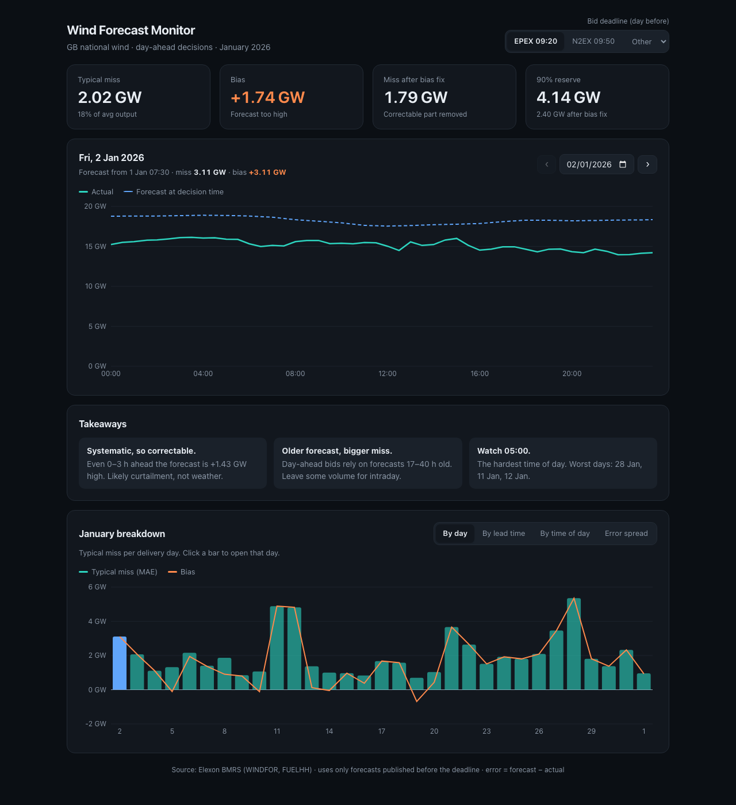

# GB Wind Forecast Monitor

A dashboard for a UK day-ahead power trading desk. For each delivery day it shows
the **national wind forecast the trader actually had at decision time**, compares
it with **what wind really generated**, and measures how far that forecast can be
trusted. It covers purchase decisions made in **January 2026**, using Elexon BMRS
data only.

**Live app:** _add the Heroku URL here after deploying (see [Deploy](#deploy-to-heroku))_



## What it shows

- **Delivery-day view.** Forecast vs actual for every half-hour, the forecast run
  that was used, and that day's error.
- **January accuracy.** MAE, RMSE, bias, bias-corrected error spread, and a P90
  reserve figure.
- **Breakdowns.** Error by delivery day, by time of day, by forecast lead time,
  and the error distribution.
- **Plain-English insights** for the trading desk.
- **Configurable decision time.** The default is 09:20 UK (EPEX SPOT GB
  gate closure), with 09:50 (Nord Pool N2EX) as a preset and any half-hour
  selectable.

Headline result (decision at 09:20 on D-1): the forecast missed by **2.02 GW**
on a typical half-hour (18% of average output). Most of that is a **+1.74 GW
systematic over-forecast**. Once the bias is corrected, the typical error is
**1.79 GW**.

## How it works

1. **Data.** `WINDFOR` (hourly forecasts, published 8 times a day) and `FUELHH`
   filtered to `fuelType = WIND` (half-hourly actuals).
2. **Align.** Hourly forecasts are interpolated to half-hours within each forecast
   run.
3. **Select.** For a slot on delivery day D, keep the latest forecast with
   `publishTime <= D-1 at the cutoff (UK time)`. Forecasts published after the
   decision are never used.
4. **Compare.** Error = forecast − actual, then aggregate.

Every choice (scope, cutoff, selection method, alignment, metrics, the bias, the
horizon limit), with the alternatives considered, evidence and sources, is in
**[docs/decisions.md](docs/decisions.md)**.

## Run it

### With Docker (recommended)

```bash
docker compose up --build
# open http://localhost:8000
```

### Without Docker (development)

Backend (Python 3.11+):

```bash
cd backend
python -m venv .venv && source .venv/bin/activate
pip install -r requirements-dev.txt
uvicorn app.main:create_app --factory --reload --port 8000
```

Frontend (Node 22), in a second terminal:

```bash
cd frontend
npm ci
npm run dev        # http://localhost:5173, proxies /api to :8000
```

### Tests and checks

```bash
cd backend && pytest -q                         # 79 tests
cd frontend && npx eslint src && npm run build  # lint + type-check + build
```

### Refresh data and re-run the approach comparison

```bash
cd backend
python -m scripts.fetch_data            # re-download from Elexon into backend/data/
python -m scripts.compare_approaches    # benchmark selection + alignment approaches
```

## Deploy to Heroku

The app ships as one Docker image (FastAPI serves the API and the built React
app). It deploys with Heroku's container stack:

```bash
heroku login
heroku create <app-name>
heroku stack:set container -a <app-name>
git push heroku main
heroku open -a <app-name>
```

`heroku.yml` tells Heroku to build the `Dockerfile`; the container listens on
`$PORT`.

## API

| Endpoint | Returns |
|---|---|
| `GET /api/meta` | Delivery window, default cutoff, presets, forecast run times |
| `GET /api/day?date=YYYY-MM-DD&cutoff=HH:MM` | Half-hourly forecast vs actual for one day, run used, metrics |
| `GET /api/summary?cutoff=HH:MM` | January metrics, per day, per time of day, error histogram |
| `GET /api/horizon?cutoff=HH:MM` | Error by forecast lead time (0–45 h), plus the lead times used at this cutoff |
| `GET /api/health` | Liveness check |

Interactive docs: `http://localhost:8000/docs`.

## Project structure

```
.
├── Dockerfile                 # Multi-stage: build React, then Python image serving API + static files
├── docker-compose.yml         # One-command local run
├── heroku.yml                 # Heroku container-stack build config
├── .github/workflows/ci.yml   # CI: backend tests, frontend lint/build, Docker build
├── docs/
│   ├── decisions.md           # Design decisions, research and evidence
│   ├── approach-comparison.txt# Output of scripts/compare_approaches.py
│   └── dashboard.png          # Screenshot
├── backend/
│   ├── app/
│   │   ├── selection.py       # Decision cutoff + choosing the forecast available at decision time (4 implementations)
│   │   ├── alignment.py       # Hourly forecasts -> half-hourly grid (hourly / hold / linear)
│   │   ├── metrics.py         # MAE, RMSE, bias, spread, nMAE, P90 reserve
│   │   ├── analysis.py        # Pairs forecasts with actuals; daily / time-of-day / horizon / histogram
│   │   ├── elexon.py          # HTTP client for the WINDFOR and FUELHH stream endpoints
│   │   ├── data.py            # Analysis window config and the CSV cache
│   │   └── main.py            # FastAPI app: endpoints, validation, caching, static frontend
│   ├── data/                  # Cached January 2026 data (windfor.csv, fuelhh_wind.csv)
│   ├── scripts/
│   │   ├── fetch_data.py      # Download data from Elexon
│   │   └── compare_approaches.py  # Benchmark the alternative approaches on real data
│   ├── tests/                 # pytest suite (written before the implementation)
│   ├── requirements.txt       # Runtime dependencies
│   └── requirements-dev.txt   # + test dependencies
└── frontend/
    ├── src/
    │   ├── App.tsx            # Page layout, state, decision-time selector
    │   ├── api.ts             # Typed API client
    │   ├── format.ts          # UK-time and MW/GW formatting
    │   ├── colors.ts          # Chart palette (light/dark)
    │   ├── index.css          # Styles and theme tokens
    │   └── components/        # KPIs, day view, insights, charts
    └── vite.config.ts         # Dev proxy to the API, build chunking
```

## Assumptions and limitations

- Delivery window is 2 Jan – 1 Feb 2026 (decisions on 1–31 Jan). See
  decisions.md §1.
- The EPEX 09:20 gate closure comes from a secondary source.
- The cause of the +1.7 GW bias (likely curtailment) is an interpretation and has
  not been verified against balancing data.
- Analysis is retrospective over one month. The bias-correction figures describe
  January; using them live would need a rolling, out-of-sample estimate.

## Use of AI tools

This project was built with the help of **Claude Code (Anthropic)**, an AI coding
assistant. It was used to:

- research the domain and the Elexon datasets
- write the tests and the implementation
- compare alternative approaches
- write documentation

A separate AI "auditor" review was also run, to check the logic and decisions
independently.

All results were checked by running the test suite and the comparison script on
real data.
